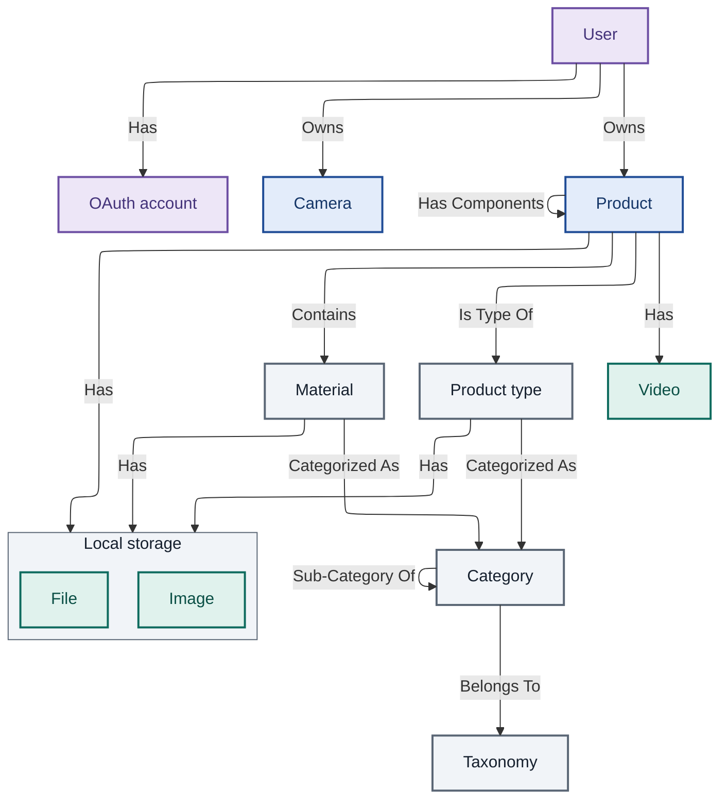

import UserManagement from '@/components/datamodel/user-management.generated.mdx';
import ReferenceData from '@/components/datamodel/reference-data.generated.mdx';
import DataCollection from '@/components/datamodel/data-collection.generated.mdx';
import FileStorage from '@/components/datamodel/file-storage.generated.mdx';
import CameraPlugin from '@/components/datamodel/camera-plugin.generated.mdx';

The diagram above is hand-drawn and simplified. The per-context diagrams below (user management, reference data, data collection, file storage, camera plugin) are generated from the ORM metadata by `backend/scripts/generate/export_datamodel.py` and list every column and foreign key. `just check` fails when they fall behind the models.

## User management

User accounts, linked OAuth accounts, and ownership and access control. Account details stay out of the product model.

<UserManagement />

Usernames are unique and indexed. They are nullable only while an OAuth-created account completes onboarding; password registration requires a username up front.

`hashed_password` and `mfa_totp_secret` appear in no read schema; the TOTP secret is also encrypted at rest. Profile statistics are counted on read, so the model no longer maps `profile_stats` and `profile_stats_computed_at` and the diagram leaves them out. The table keeps both columns for the previous release; the next release drops them. `upload_file_count` and `upload_total_bytes` hold the per-account upload quota ledger.

## Reference data

Taxonomies, categories and subcategories, materials, product types, and units. These records are shared across users and products.

<ReferenceData />

`materialproductlink` records how much of a material sits in a product. It carries a measurement, not a classification, so it appears in the data collection diagram below.

## Data collection

`Product` holds both top-level products and nested components, so a disassembly tree needs no separate parts table.

- a product can have a parent product, enabling component hierarchies
- physical measurements are first-class product fields
- circularity notes are stored on the product as nullable JSON with optional `recyclability`, `disassemblability`, and `remanufacturability` fields
- ownership is attached to the user level
- materials, product types, and media can be linked without making every field mandatory
- `completeness` (0 to 1) and `recommended_rank` are derived, and database triggers keep them current on every product and image write. `completeness` is the weighted share of the app's missing-data checklist a product has filled in, with a photo counting three times any other field. `recommended_rank` is the creation time in epoch seconds plus up to 30 days in proportion to completeness. It is a sort key only, so its value means nothing on its own
- `product_revision` records the edit history. Each changing update of a product's own fields adds a row with the editor, the resulting `version`, the names of the changed fields and a JSON snapshot of the editable fields as the edit left them. Media, components and the bill of materials are not covered. The API returns the snapshot only to the owner and admins. Revisions are kept for two years, and the history starts with the release that added it: earlier edits are not recorded

<DataCollection />

## File storage and media

Files and images use polymorphic associations to products, materials, or product types. Videos are linked by URL, not stored.

<FileStorage />

`video` sits in this context because the row is a media reference (a URL and its metadata), like the other two.

## Camera plugin

The Raspberry Pi camera integration owns two tables. `camera` holds a paired device and the relay credential that authenticates it; `recording_session` links a live broadcast to the video row it produces. [r9cam plugin](/architecture/r9cam/) covers the pairing and streaming path these tables support.

<CameraPlugin />
