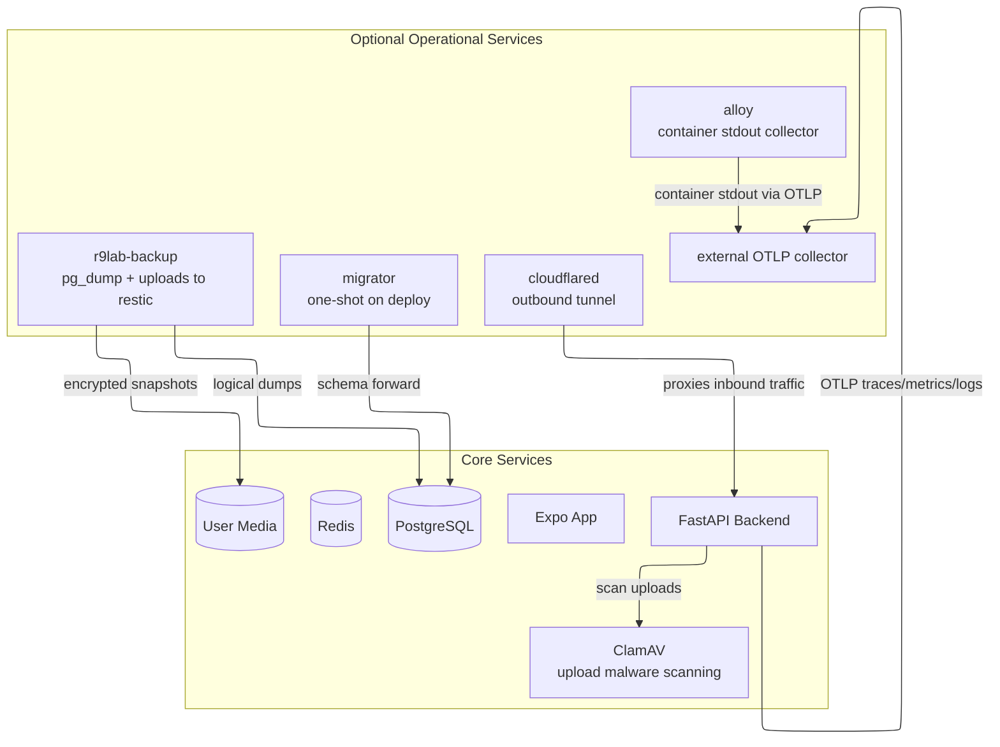

R9lab runs as a self-hosted Docker Compose stack sized for a single VPS. This page describes how
that stack is put together. For running it, see [Backups and recovery](/operations/backups/),
[Secrets and rotation](/operations/secrets/) and [Telemetry and monitoring](/operations/monitoring/).

## Compose service topology

Docker Compose defines the whole stack. Core services run in every environment; migrations, backups, the Cloudflare tunnel, and telemetry shipping are optional operational services.



The Astro landing page and the Starlight docs site are not part of this topology: they are static sites on Cloudflare Workers, deployed by `.github/workflows/deploy-sites.yml` on every release, by hand, and weekly on staging (so its landing page picks up a changed featured teardown). Prod deploys wait for a required reviewer, so a release reaches prod's sites only after staging has been checked. They reach the backend only from the visitor's browser and from their own build.

Compose profiles enable the backup services. `OTEL_EXPORTER_OTLP_ENDPOINT` enables the backend's OTLP export and includes the Alloy overlay that ships every other container's stdout.

## Supported delivery path

- Docker Compose is the runtime for staging and production.
- `compose.yaml` is the shared base topology.
- `compose.dev.yaml`, `compose.ci.yaml`, and `compose.deploy.yaml` are the supported environment overlays.
- Prod and staging share `compose.deploy.yaml`; the `just stack <env>` argument selects which. The root `.env` supplies everything host-local: the public origins, the tunnel token, OAuth client IDs, email sender metadata, the initial superuser identity, telemetry endpoints, and backup paths. One host serves one environment; the deploy recipes refuse a mismatch. Manual shell helpers read exported environment variables, not `.env`.
- GitHub Actions validate changes, run security checks, and maintain release automation. A release publishes the backend and app images to GHCR and deploys the landing page and docs to Cloudflare Workers; the Compose stacks pull their images when an operator runs the deploy from the server checkout.
- Cloudflare DNS, Tunnel hostnames, the Workers custom domains, and the GitHub Environments the release reads its URLs from live in `infra/cloudflare/`. OpenTofu owns only the public edge; Compose owns the runtime services.

Docker development and E2E ports bind to localhost by default. To test Expo from another device over a LAN, run the Expo dev server from `app/` on the host instead of the Docker app service.

## Cloudflare edge as code

OpenTofu in `infra/cloudflare/` manages DNS records, separate prod and staging Cloudflare
Tunnels, their ingress rules, and a final `http_status:404` catch-all for unknown hostnames.
Tunnel origins point at Compose services such as `http://api:8000` and `http://app:8081`.
`infra/cloudflare-zone/` holds the zone-wide TLS settings and rulesets that both environments
share; [Security and hardening](/operations/security/#inbound-edge) describes the rules.

Prod and staging have separate OpenTofu workspaces and state. Start public hostname changes in
`infra/cloudflare/`. Do not add wildcard DNS records without a concrete operational need and a
blast-radius review.

## Network segmentation policy

Public-facing services use the `edge` network, data services the internal `data` network, and upload scanning the private `scanning` network. Only the API bridges networks. The repo adds no proxies, VLANs, or host firewall rules.

| Service group | Compose networks | Host ports in prod/staging |
| --- | --- | --- |
| `cloudflared`, `app` | `edge` only | none |
| `api` | `edge`, `data`, `scanning` | none |
| `postgres`, `redis`, `migrator`, `backup` | `data` only | none |
| `clamav` (`scanning` profile only) | `scanning` only | none |

`just compose-config` validates that the supported Compose overlays render for dev, prod, and staging.
`just deploy-secrets-check` validates the rendered secret files (paths, modes, no placeholders) and that the telemetry variables are set together.

## Backend egress

Backend outbound HTTP is restricted to `OUTBOUND_HTTP_ALLOWED_URLS`. See
[Security and hardening](/operations/security/#backend-egress) for the policy
model.

## Transport security

Production and staging are HTTPS-only behind Cloudflare Tunnel. The zone configuration in
`infra/cloudflare-zone/` enforces TLS 1.2 or newer, enables TLS 1.3, and redirects HTTP requests to
HTTPS before they reach the tunnel.

Every deployed browser-facing origin emits:

```http
Strict-Transport-Security: max-age=63072000; includeSubDomains
```

The app sets it in Caddy, the landing page and docs in the `_headers` file their Workers serve, and the API sets it from FastAPI in `prod` and `staging`. `preload` is omitted because the full `r9lab.io` subdomain inventory has not been verified for preloading.

PostgreSQL and Redis stay on the private Compose `data` network, so `DATABASE_TLS=false` and
`REDIS_TLS=false` are the defaults. If either service moves off that network, set
`DATABASE_TLS=true` or `REDIS_TLS=true`, and set the matching CA file variable for a private CA.
See [Security and hardening](/operations/security/) for the trust-boundary model.

Supported browsers must implement HTTPS, HSTS, Content Security Policy, host-prefixed secure cookies, SameSite cookies, CORS preflight enforcement, `Cross-Origin-Opener-Policy`, and `Cross-Origin-Resource-Policy`. There is no fallback security mode: unsupported browsers may fail to authenticate, fail to load protected media, or be blocked by browser policy.

The backend enforces stricter secret, origin and host checks outside development.
